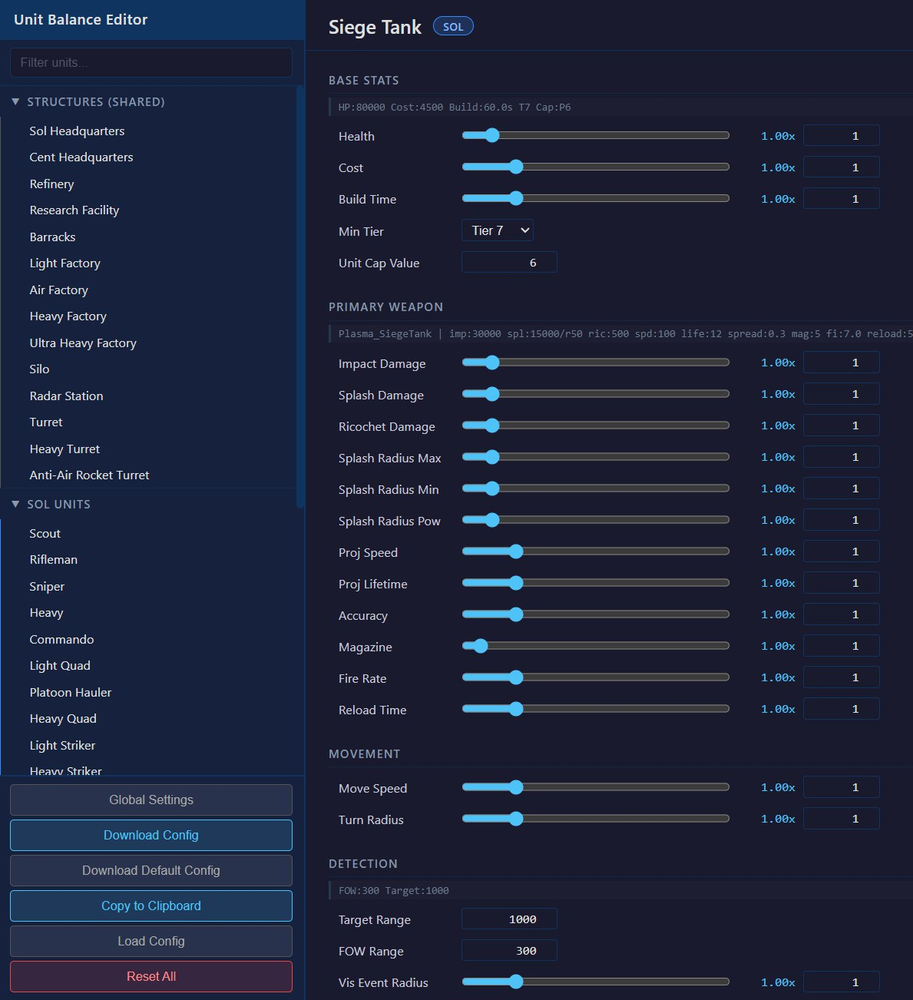

# Si_UnitBalance

A [Silica](https://store.steampowered.com/app/504900/Silica/) server mod for fine-tuning unit and structure stats. Includes a full **in-game admin UI** (`!b` chat command) for live editing — no config file editing or server restarts needed.

Almost all changes are synced to clients via the game's built-in OverrideManager — no client-side mod required. The exception is the turret-aim overrides (`pitch_max_up` / `pitch_max_down` / `aim_compensation`), which act on non-networked `VehicleTurret` component fields and therefore affect **AI-controlled turrets only** — see [Ballistics & Turret Aim](#ballistics--turret-aim).

> 🛠️ **Author / preview config JSONs in the browser** with the **[Unit Balance Interactive Tool](https://drmuck.github.io/Si_UnitBalance_Interactive/)** — a single-page web app that lets you see every parameter side-by-side with its vanilla base, edit multipliers and absolute overrides, and export a ready-to-deploy `Si_UnitBalance_Config.json`. Perfect for crafting a full balance pass offline before pushing it to the server. Tool source: [github.com/DrMuck/Si_UnitBalance_Interactive](https://github.com/DrMuck/Si_UnitBalance_Interactive).



*Screenshot from the [interactive tool](https://drmuck.github.io/Si_UnitBalance_Interactive/): Sol's Siege Tank parameter sheet, with the vanilla base line shown above each group and live multipliers (e.g. Impact Damage 1.00×, Splash Radius Max 1.00×) plus absolute fields (Target Range, FOW Range). Pick a unit on the left, tune the sliders / inputs on the right, then **Download Config** to grab a ready-to-deploy `Si_UnitBalance_Config.json`.*

## Requirements

- [MelonLoader](https://github.com/LavaGang/MelonLoader) for Silica
- **[Silica Admin Mod](https://github.com/data-bomb/Silica)** by databomb — required for `!rebalance` / `!b` chat commands and admin permissions

## Installation

1. Install MelonLoader and the [Silica Admin Mod](https://github.com/data-bomb/Silica) package
2. Copy `Si_UnitBalance.dll` to your server's `Mods/` folder
3. Copy `Si_UnitBalance_Config.json` to your server's `Mods/` folder (optional — a default config is created if missing)
4. Start the server

## In-Game Balance Editor (`!b`)

Admins can type `!b` in chat to open an interactive menu for editing any unit or structure parameter live during a match. Navigate with `.1`-`.9` to select, `.back` to go up, `.0` to exit.

```
!b (Root Menu)
├── 1. Sol              — Sol faction units & structures
├── 2. Centauri         — Centauri faction units & structures
├── 3. Alien            — Alien faction units & structures
├── 4. JSON             — Save / Load / Reset configs
├── 5. HTP              — Hoverbike, Tier, Teleportation, misc toggles
├── 6. Cap&Decay        — Unit cap, structure decay, count caps
└── 7. Strategystyle    — Alien nest-centric build rules
```

### Unit Parameter Groups

Selecting a unit opens these parameter groups:

| Group | Parameters |
|---|---|
| **Health & Production** | `health_mult`, `cost_mult`, `build_time_mult`, `min_tier`, `build_radius` |
| **Primary Weapon** | `damage_mult`, `proj_speed_mult`, `proj_lifetime_mult`, `accuracy_mult`, `magazine_mult`, `fire_rate_mult`, `reload_time_mult` |
| **Secondary Weapon** | Same as primary (shown only if unit has a second weapon) |
| **Movement** | `move_speed_mult`, `jump_speed_mult`, `turbo_speed_mult`, `turn_radius_mult` |
| **Vision & Sense** | `target_distance`, `fow_distance`, `visible_event_radius_mult` |

Each parameter displays its current value and the vanilla base value from the game prefab:
```
1. damage_mult = 1.50 (base: 25)
```

To set a value: `.1 1.5` (sets parameter #1 to 1.5), then confirm with `.1` (save), `.2` (cancel), or `.3` (save + rebalance immediately).

### HTP Menu (Hover / Tier / Teleportation)

| Option | Description |
|---|---|
| **1. Hoverbike** | All Hover Bike parameters (moved here from Sol > Barracks) + `dispense_timeout` + `min_tier` enforcement |
| **2. Tier** | Tech-up research time per tier (Tier 1-8, default 30s each) |
| **3. Teleportation** | HQ teleport cooldown (default 120s) and duration (default 5s) |
| **4. Shrimp Aim** | Toggle shrimp AI targeting on/off (shown as `[ON]`/`[OFF]`) |
| **5. Additional Spawn** | Toggle (applies next game) |
| **6. Discord** | Auto-post toggle + webhook URL |
| **7. Watchdog** | Round-transition stall recovery toggle |

### Cap&Decay Menu

| Option | Description |
|---|---|
| **1. Decay** | Per-faction structure decay when unlinked from HQ/Nest (enable, keep_production, delay, tick, amount_pct, randomize_pct) |
| **2. Player Cap Exempt** | Toggle: player-controlled infantry don't fill the unit cap (immediate) |
| **3. Unit Cap Mult 2-way** | CapBase × mult for HvH / HvA matches. `.1 <mult>`; `-1` = server capmult, `0` = unlimited. Applies to the running match on save |
| **4. Unit Cap Mult 3-way** | Same for HvHvA / H2vA matches |
| **5. Shrimp Cap** | Absolute per-team max of alien Shrimps (alive + queued + in production). `.1 <max>`; `-1` = unlimited. Builds beyond the cap are refused and the commander gets a chat warning. Immediate |
| **6. Harvester Cap** | Same for Sol/Centauri harvesters |

### Strategystyle Menu

Alien nest-centric build rules. Not for the RTS-AI server (its alien planner expands via Node lines).

| Option | Description |
|---|---|
| **1. Alien Nest-Only Build** | Toggle: only Nests act as construction anchors for aliens (cysts/nodes/caches no longer extend the build area — expand by building new Nests). `!rebalance` to apply |
| **2. Alien Nest Reach Radius** | Nodes and Bio Caches may only be placed within this distance (metres, 2D) of a friendly Nest — built or under construction. Further placements are refused and the commander gets a chat warning + a sound. `.1 <metres>`; `-1` = vanilla (no limit). Immediate |
| **3. Alien Queens** | Max Queens per team. Every newly built Nest spawns its own docked Queen while the team is below max (vanilla `1` = only the starting Nest). `.1 <n>`; `0` = every Nest; `-1` = vanilla. Server-side, immediate for Nests built after saving |
| **4. Alien Nest Finished-Anchor Only** | Toggle: a new Nest must be within anchor range (`build_radius`) of a *finished* structure — a Nest still under construction can't anchor the next one (vanilla accepts construction sites as anchors, so aliens can chain Nest → Nest → Nest before the previous one exists). Parallel Nests off a finished Nest are fine. Refused placements cost nothing; the commander gets a chat warning + a sound. Immediate |
| **5. Queen Logistics per Nest** | Toggle: an alien structure can only build / produce while its **nearest finished Nest** (2D distance; a Nest counts as its own) has its Queen docked. Vanilla checks team-wide — one docked Queen anywhere unlocks everything, so only the starter Queen leaving (with no other Queen docked) ever blocks building. With one Nest identical to vanilla; with expansion Nests every structure depends on the Queen of the Nest it sits closest to. Needs **3. Alien Queens** `0` (or N) so expansion Nests have a Queen. Refused requests cost nothing; commander gets a chat warning + a sound. Immediate |

### JSON Config Management

| Option | Description |
|---|---|
| **Reset to Blank** | Reverts all parameters to vanilla (confirm required) |
| **Save Current** | Saves current config to `Mods/Si_UnitBalance_Configs/` with timestamp |
| **Load Saved** | Lists saved configs, pick one to load (confirm required) |

## Hot-Reload

Type `!rebalance` in chat (admin only) to:
1. Revert all current overrides
2. Reload the config from disk
3. Re-apply all overrides
4. Sync changes to all connected players

Type `!rebalance default` to revert to vanilla settings without re-applying.

## Config File Reference

The JSON config (`Si_UnitBalance_Config.json`) can also be edited manually. The in-game `!b` menu reads and writes this same file.

### Per-Unit Parameters (synced via OverrideManager)

| Parameter | Type | Description |
|---|---|---|
| `damage_mult` | multiplier | Scales all projectile damage fields (impact, ricochet, splash, penetrating) |
| `health_mult` | multiplier | Scales unit max health |
| `cost_mult` | multiplier | Scales construction/spawn cost |
| `build_time_mult` | multiplier | Scales build/spawn time |
| `min_tier` | absolute | Override minimum tech tier required |
| `build_radius` | absolute | Build radius override (alien structures) |
| `range_mult` | multiplier | Scales weapon range (targeting distance + projectile lifetime/raycast) |
| `target_distance` | absolute | Sensor.TargetingDistance override |
| `fow_distance` | absolute | Sensor.FogOfWarViewDistance override |
| `proj_speed_mult` | multiplier | Scales projectile speed |
| `proj_lifetime_mult` | multiplier | Scales projectile lifetime |
| `reload_time_mult` | multiplier | Scales weapon reload time |
| `accuracy_mult` | multiplier | Scales projectile spread (lower = tighter) |
| `magazine_mult` | multiplier | Scales magazine capacity |
| `fire_rate_mult` | multiplier | Scales fire rate (divides fire interval) |
| `move_speed_mult` | multiplier | Scales movement speed |
| `turbo_speed_mult` | multiplier | Scales boost/turbo speed |
| `jump_speed_mult` | multiplier | Scales soldier jump speed |
| `turn_radius_mult` | multiplier | Scales vehicle turn radius (lower = tighter) |
| `visible_event_radius_mult` | multiplier | Scales projectile visual render distance |
| `dispense_timeout` | absolute | VehicleDispenser cooldown in seconds (Hoverbike) |

Per-weapon variants use `pri_` / `sec_` prefixes (e.g., `pri_damage_mult`, `sec_fire_rate_mult`).

### Ballistics & Turret Aim

Grouped under **Ballistics** in the `!b` menu. The first block acts on the unit's `ProjectileData` and is fully synced to clients; the turret-aim block acts on the `VehicleTurret` component (see the ⚠️ limitation below).

| Parameter | Type | Description |
|---|---|---|
| `impact_scale_by_speed` | bool | Impact damage scales with the projectile's current (drag-reduced) speed. `true` = damage falls off with range; `false` = flat damage (e.g. Siege plasma). |
| `drag_mult` | multiplier | Scales projectile air drag (`m_fDragCoefficient`). `<1` = flatter, longer-carrying shot & gentler falloff; `>1` = slows faster. |
| `ai_lead_velocity` | multiplier | AI aim-lead velocity factor (layered on the automatic speed compensation). `>1` = AI leads more. |
| `ai_lead_gravity` | multiplier | AI aim-lead gravity factor. Raise for high-arc shells that land short. |
| `ai_lead_drag` | multiplier | AI aim-lead drag factor. Raise if AI under-leads a draggy (decelerating) shell. |
| `pitch_max_up` | absolute° | Max turret **elevation** in degrees (`VehicleTurret.PitchMaxUp`). `-1` = vanilla. |
| `pitch_max_down` | absolute° | Max turret **depression** in degrees (`VehicleTurret.PitchMaxDown`). `-1` = vanilla. |
| `aim_compensation` | enum 0–4 | Forces the turret ballistic-drop compensation mode (`ETurretAimCompensation`). `-1` = vanilla. |

> ⚠️ **Turret-aim overrides (`pitch_max_up`, `pitch_max_down`, `aim_compensation`) affect AI-controlled turrets only — not human players.**
> These are per-instance fields on the `VehicleTurret` component, which is **not** an asset or a networked/`SyncVar` value, so the server cannot push the change to clients (unlike `ProjectileData`, which is a shared asset the OverrideManager *does* sync). For a vehicle a player is driving, the turret's pitch clamp and aim reticle are computed **client-side** from the client's own vanilla component values, so a server-side override is invisible to that player. It does correctly retune **bot** turrets, which aim on the server. There is no server-side path to change a human player's turret elevation or aim compensation; that would require the aim value being networked by the base game or a client-side mod. `aim_compensation` looks like it works on the Siege Tank only because that mode is baked into the Siege Tank's client prefab by the base game.

### Per-Projectile Absolute Overrides

Set exact values on specific ProjectileData fields:
```json
"Combat Tank": {
    "projectiles": {
        "ProjectileData_Shell_CombatTank": {
            "m_fImpactDamage": 3000,
            "m_fRicochetDamage": 1000,
            "m_fBaseSpeed": 550,
            "m_fLifeTime": 4
        }
    }
}
```

### Global Settings

| Parameter | Description |
|---|---|
| `enabled` | Enable/disable the mod (default: `true`) |
| `shrimp_disable_aim` | Disable Shrimp AI targeting (default: `false`) |
| `dump_fields` | Dump unit field data to logs on game start (default: `false`) |

### Teleportation (pseudo-unit `_teleport`)

```json
"units": {
    "_teleport": {
        "cooldown": 90,
        "duration": 3
    }
}
```

### Tech Time

```json
"tech_time": {
    "tier_1": 30,
    "tier_2": 60,
    "tier_3": 90
}
```

## Building from Source

```
cd Si_UnitBalance
dotnet build -c Release
```

Output: `Si_UnitBalance/bin/Release/netstandard2.1/Si_UnitBalance.dll`

Reference DLLs from your Silica server's `Silica_Data/Managed/` folder are needed in `include/netstandard2.1/`.
